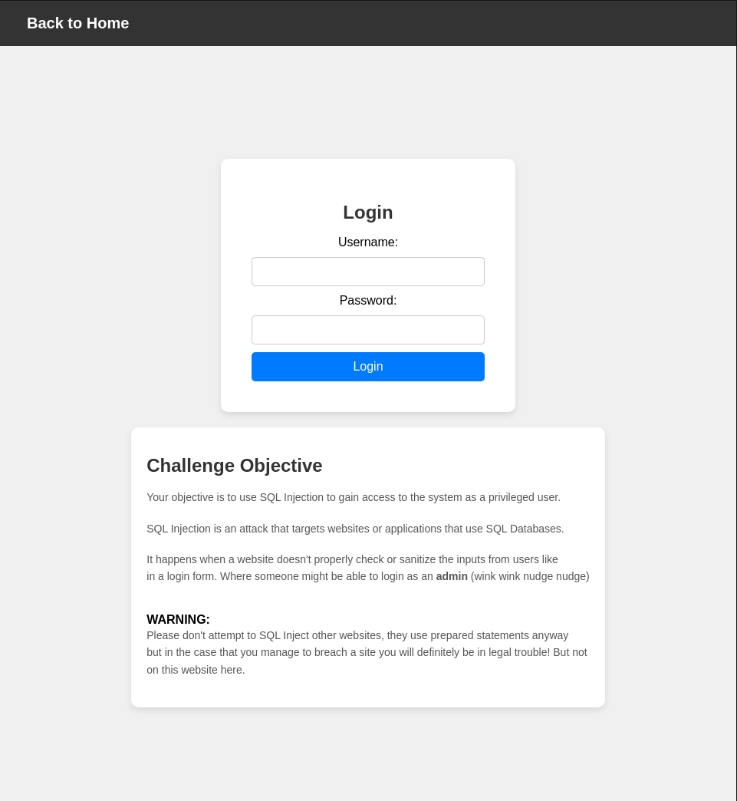
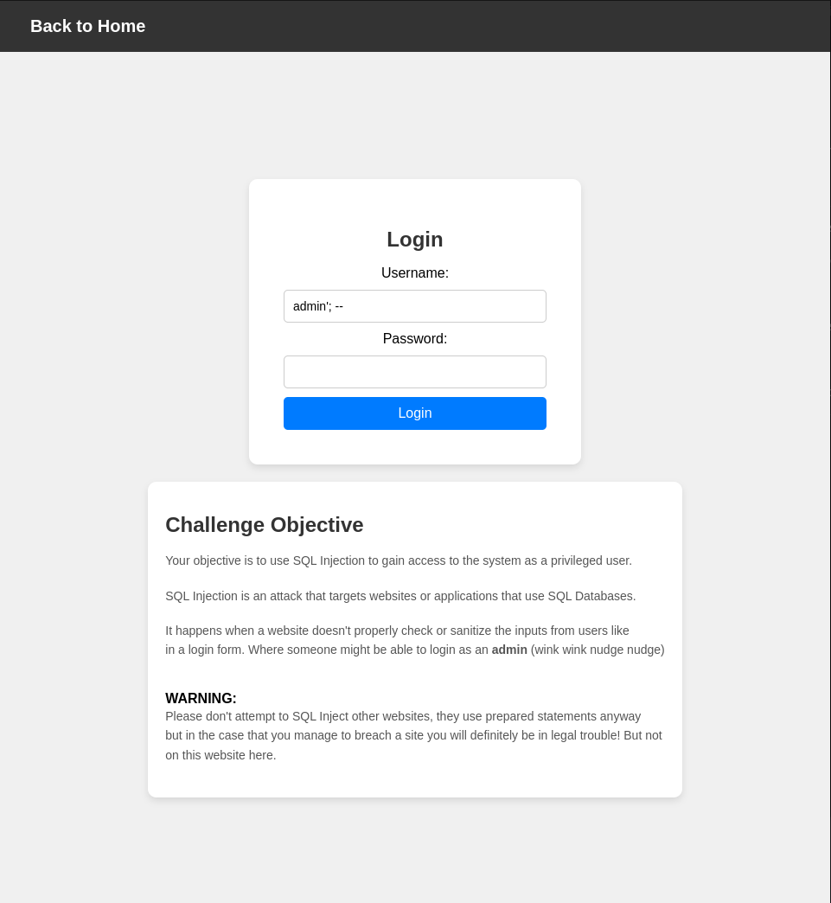
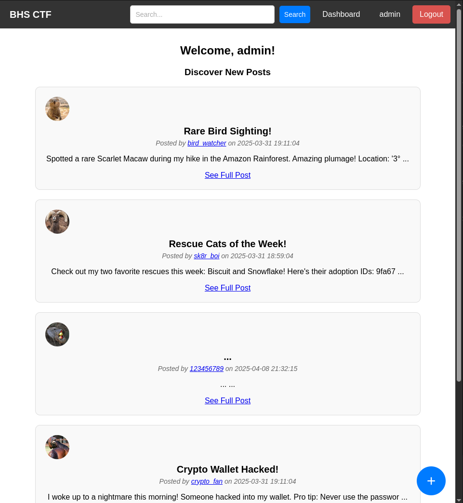
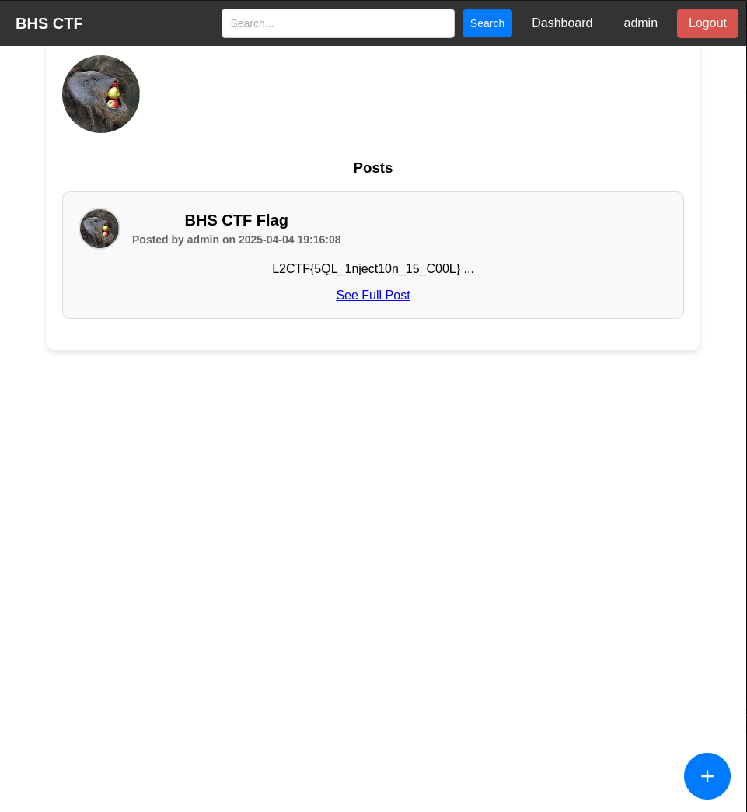

In this challenge we are trying to use SQL Injection to gain access to the webapp and get the flag!


## SQL Injection

The unsafe query is ```SELECT * FROM users WHERE username = '{username}' and password = '{password}' ```

This query is unsafe since it directly adds user input into the query and can execute code.



After using the input ```admin'; --``` in the admin input we get into the webapp home.



Once in the webapp we can go into the admin profile, where we can see the post that contains the flag.



Now we have the flag!.
